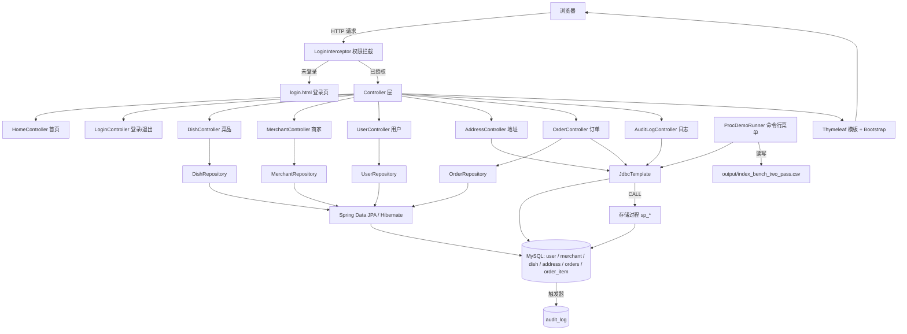

# 🍽️ FoodOrdering 点餐系统

基于 **Spring Boot 3 + Thymeleaf + MySQL** 的外卖点餐 Web 应用。项目采用经典三层架构（Controller / Repository / Entity），并在数据层深度使用 **MySQL 存储过程、触发器与索引**，同时内置一个命令行实验工具用于数据库特性验证与性能测速。

适合作为 Java Web 全栈学习与数据库原理实践的教学/课设型项目。

---

## 目录

- [核心特性](#核心特性)
- [技术栈](#技术栈)
- [项目结构](#项目结构)
- [架构设计](#架构设计)
- [数据库设计](#数据库设计)
- [角色与权限](#角色与权限)
- [功能与路由清单](#功能与路由清单)
- [环境要求](#环境要求)
- [快速开始](#快速开始)
- [登录账号说明](#登录账号说明)
- [命令行实验工具](#命令行实验工具)
- [配置说明](#配置说明)
- [已知问题](#已知问题)
- [改进方向](#改进方向)
- [常见问题](#常见问题)

---

## 核心特性

| 分类 | 说明 |
| --- | --- |
| 多角色登录 | 支持 **普通用户 / 商家 / 管理员** 三种角色，基于 `HttpSession` 保存登录态 |
| 权限拦截 | 自定义 `HandlerInterceptor` 按 URL 前缀做角色级访问控制 |
| 业务 CRUD | 菜品、商家、用户、收货地址、订单五类资源的增删改查 |
| 下单流程 | 单菜品下单，经由存储过程 `sp_create_order_single_item` 保证事务一致性 |
| 订单状态机 | `created → paid → accepted → done / cancelled`，通过 `sp_update_order_status` 流转 |
| 存储过程 | 4 个存储过程封装复杂查询、跨表插入、状态更新与级联删除校验 |
| 触发器审计 | 数据变更自动写入 `audit_log` 表，Web 端可查看最近 100 条日志 |
| 索引实验 | 一键对比 `orders.status` 有无索引时的查询平均耗时，结果落地 CSV |
| 服务端渲染 | Thymeleaf 模板 + Bootstrap 5.3 CDN，无需前端构建工具 |

---

## 技术栈

### 后端框架

| 组件 | 版本 / 说明 |
| --- | --- |
| Java | 17 |
| Spring Boot | 3.5.14（parent: `spring-boot-starter-parent`） |
| Spring Web | `spring-boot-starter-web`，内嵌 Tomcat |
| Spring Data JPA | `spring-boot-starter-data-jpa`，Hibernate 实现 |
| Spring JDBC | `JdbcTemplate`，用于存储过程调用与动态 SQL |
| Thymeleaf | `spring-boot-starter-thymeleaf`，服务端模板渲染 |
| Spring Boot Test | `spring-boot-starter-test`（JUnit） |

### 数据存储

| 组件 | 说明 |
| --- | --- |
| MySQL | 8.x，驱动 `com.mysql:mysql-connector-j`（runtime） |
| 表 | `user`、`merchant`、`dish`、`address`、`orders`、`order_item`、`audit_log` |
| 存储过程 | `sp_get_order_detail`、`sp_create_order_single_item`、`sp_update_order_status`、`sp_delete_address` |
| 触发器 | 数据变更写入 `audit_log` |
| 索引 | `idx_orders_status`（实验中动态创建/删除） |

### 前端

- Bootstrap 5.3.0（jsDelivr CDN）
- 原生 HTML + Thymeleaf 属性（`th:text`、`th:if`、`th:each`）
- 无 Node 构建依赖

### 构建工具

- Maven 3（项目自带 Wrapper：`mvnw` / `mvnw.cmd`）

---

## 项目结构

```text
food-ordering-web/
├── pom.xml                                  Maven 依赖与构建配置
├── mvnw / mvnw.cmd                          Maven Wrapper
├── .gitignore                               忽略 target/、.idea/ 等
├── output/                                  索引实验 CSV 输出目录（运行时生成）
└── src/
    ├── main/
    │   ├── java/com/wxz/food_ordering_web/
    │   │   ├── FoodOrderingWebApplication.java   Spring Boot 启动类
    │   │   ├── ProcDemoRunner.java               命令行实验工具（存储过程 + 索引测速）
    │   │   ├── config/
    │   │   │   ├── LoginInterceptor.java         登录与角色权限拦截器
    │   │   │   └── WebConfig.java                注册拦截器、配置放行路径
    │   │   ├── controller/
    │   │   │   ├── HomeController.java           首页
    │   │   │   ├── LoginController.java          登录 / 退出
    │   │   │   ├── DishController.java           菜品管理
    │   │   │   ├── MerchantController.java       商家管理
    │   │   │   ├── UserController.java           用户管理
    │   │   │   ├── AddressController.java        地址管理（纯 JdbcTemplate）
    │   │   │   ├── OrderController.java          订单管理 + 下单（存储过程）
    │   │   │   └── AuditLogController.java       审计日志查询
    │   │   ├── entity/
    │   │   │   ├── User.java                     映射 user 表
    │   │   │   ├── Merchant.java                 映射 merchant 表
    │   │   │   ├── Dish.java                     映射 dish 表
    │   │   │   └── Order.java                    映射 orders 表（避开 MySQL 保留字）
    │   │   ├── repo/
    │   │   │   ├── UserRepository.java
    │   │   │   ├── MerchantRepository.java
    │   │   │   ├── DishRepository.java
    │   │   │   └── OrderRepository.java
    │   │   └── service/
    │   │       └── DishService.java              菜品业务层（当前控制器未调用）
    │   └── resources/
    │       ├── application.properties            应用配置
    │       ├── static/                           静态资源（当前为空）
    │       └── templates/                        14 个 Thymeleaf 页面
    └── test/java/com/wxz/food_ordering_web/
        └── FoodOrderingWebApplicationTests.java
```

### 模板文件一览

| 页面 | 用途 |
| --- | --- |
| `login.html` | 登录表单（用户名 / 密码 / 角色下拉） |
| `index.html` | 首页功能卡片，按角色动态显示 |
| `dish_list.html` / `dish_form.html` | 菜品列表与新增/编辑表单 |
| `merchant_list.html` / `merchant_form.html` | 商家列表与表单 |
| `user_list.html` / `user_form.html` | 用户列表与表单 |
| `address_list.html` / `address_form.html` | 地址列表与表单 |
| `order_list.html` | 订单列表（支持 asc/desc 排序） |
| `order_new.html` | 下单页面 |
| `order_detail.html` | 订单详情（主信息 + 明细项） |
| `audit_log_list.html` | 审计日志列表 |

---

## 架构设计



**分层说明**

1. **Controller 层**：接收请求、组织模型数据、返回模板名或重定向。项目中有意混用两种数据访问方式以作对比：
   - 简单单表 CRUD → **Spring Data JPA**（`DishController`、`MerchantController`、`UserController`、`OrderController.list`）
   - 多表联查 / 存储过程调用 → **JdbcTemplate**（`AddressController`、`AuditLogController`、`OrderController.detail`）
2. **Repository 层**：继承 `JpaRepository`，通过方法名派生查询（如 `findByNickname`、`findByMerchantId`、`findByNameContaining`）。
3. **Entity 层**：JPA 注解映射数据库表，`Order` 实体映射到 `orders` 表以避开 MySQL 保留字。
4. **数据库层**：复杂业务逻辑下沉到存储过程，数据变更由触发器记录到审计表。
5. **实验工具**：`ProcDemoRunner` 实现 `CommandLineRunner`，应用启动后提供交互式菜单。

---

## 数据库设计

### 表结构

#### `user`（用户）

| 字段 | 类型 | 约束 | 说明 |
| --- | --- | --- | --- |
| `user_id` | BIGINT | PK, AUTO_INCREMENT | 用户 ID |
| `nickname` | VARCHAR(50) | NOT NULL | 昵称，同时作为**登录用户名** |
| `phone` | VARCHAR(20) | NOT NULL | 手机号 |
| `role` | VARCHAR(20) | | 角色：`user` / `admin` |
| `created_at` | DATETIME | | 创建时间，实体默认 `LocalDateTime.now()` |

#### `merchant`（商家）

| 字段 | 类型 | 约束 | 说明 |
| --- | --- | --- | --- |
| `merchant_id` | BIGINT | PK, AUTO_INCREMENT | 商家 ID |
| `name` | VARCHAR(100) | NOT NULL | 商家名称 |
| `phone` | VARCHAR(20) | NOT NULL | 联系电话 |
| `rating` | DECIMAL(3,2) | | 评分 |
| `status` | VARCHAR(20) | NOT NULL | 营业状态 |
| `username` | VARCHAR(50) | | 商家登录账号 |
| `password` | VARCHAR(100) | | 登录密码 |
| `created_at` | DATETIME | | 创建时间 |

#### `dish`（菜品）

| 字段 | 类型 | 约束 | 说明 |
| --- | --- | --- | --- |
| `dish_id` | BIGINT | PK, AUTO_INCREMENT | 菜品 ID |
| `merchant_id` | BIGINT | NOT NULL, FK → merchant | 所属商家 |
| `name` | VARCHAR(100) | NOT NULL | 菜品名称 |
| `price` | DECIMAL(10,2) | NOT NULL | 单价 |
| `on_sale` | TINYINT | NOT NULL，默认 1 | 是否上架（1 上架 / 0 下架） |
| `created_at` | DATETIME | | 创建时间 |

#### `address`（收货地址）

| 字段 | 类型 | 说明 |
| --- | --- | --- |
| `address_id` | BIGINT PK | 地址 ID |
| `user_id` | BIGINT | 所属用户 |
| `receiver_name` | VARCHAR | 收货人 |
| `receiver_phone` | VARCHAR | 收货电话 |
| `region` | VARCHAR | 区域 |
| `detail` | VARCHAR | 详细地址 |
| `is_default` | TINYINT | 是否默认地址 |

> 该表没有对应实体类，全部通过 `JdbcTemplate` 操作。

#### `orders`（订单）

| 字段 | 类型 | 说明 |
| --- | --- | --- |
| `order_id` | BIGINT PK | 订单 ID |
| `user_id` / `merchant_id` / `address_id` | BIGINT NOT NULL | 关联用户、商家、地址 |
| `status` | VARCHAR(20) NOT NULL | `created` / `paid` / `accepted` / `done` / `cancelled` |
| `total_amount` | DECIMAL(10,2) | 订单总额 |
| `pay_method` | ENUM('alipay','wechat') | 支付方式 |
| `paid_at` | DATETIME | 支付时间（状态变为 paid 时由存储过程填充） |
| `created_at` / `updated_at` | DATETIME | 创建/更新时间 |

#### `order_item`（订单明细）

| 字段 | 说明 |
| --- | --- |
| `order_id` | 所属订单 |
| `dish_id` | 菜品 ID |
| `qty` | 数量 |
| `deal_price` | 成交单价 |
| `subtotal` | 小计 |

#### `audit_log`（审计日志）

| 字段 | 说明 |
| --- | --- |
| `log_id` | 自增主键 |
| `event_time` | 事件时间 |
| `event_type` | 事件类型（INSERT / UPDATE / DELETE） |
| `table_name` | 被操作的表 |
| `ref_id` | 关联业务主键 |
| `detail` | 变更详情 |

由数据库触发器自动写入，应用侧只读。

### 存储过程

| 名称 | 参数 | 作用 |
| --- | --- | --- |
| `sp_get_order_detail(order_id)` | IN `order_id` | 返回订单主信息及各关联字段，可返回多个结果集 |
| `sp_create_order_single_item(user_id, merchant_id, address_id, dish_id, qty, pay_method)` | 6 个 IN 参数 | 单菜品下单：写 `orders` + `order_item`，计算总额，返回 `new_order_id`、`total_amount` |
| `sp_update_order_status(order_id, status)` | 2 个 IN 参数 | 更新订单状态，置为 `paid` 时同步 `paid_at` |
| `sp_delete_address(address_id, user_id)` | 2 个 IN 参数 | 校验地址归属后删除，避免越权删除 |

### 索引

| 名称 | 定义 | 说明 |
| --- | --- | --- |
| `idx_orders_status` | `CREATE INDEX idx_orders_status ON orders(status)` | 用于 `SELECT COUNT(*) FROM orders WHERE status='paid'` 的性能对比实验，实验中会被动态创建/删除 |

> ⚠️ **当前仓库未包含建库脚本（.sql 文件）**。表结构、存储过程、触发器需要单独准备，建议导出后放入 `src/main/resources/db/schema.sql`，详见[快速开始](#快速开始)。

---

## 角色与权限

`LoginInterceptor` 基于 Session 中的 `role` 与请求 URI 前缀做判断：

| 角色 | 允许访问 | 被拦截（重定向到 `/`） |
| --- | --- | --- |
| `admin`（管理员） | 全部功能 | 无 |
| `user`（普通用户） | `/`、`/dishes`、`/orders`、`/orders/new`、`/logout` | `/merchants`、`/users`、`/audit-logs`、`/addresses` |
| `merchant`（商家） | `/`、`/dishes`、`/logout` | `/merchants`、`/users`、`/audit-logs`、`/orders` |

放行路径：`/login`、`/css/**`、`/js/**`（在拦截器内和 `WebConfig` 的 `excludePathPatterns` 中均做了配置）。

未登录访问任何受保护路径 → 重定向 `/login`。

---

## 功能与路由清单

### 登录与首页

| 方法 | 路径 | 说明 |
| --- | --- | --- |
| GET | `/` | 首页功能卡片 |
| GET | `/login` | 登录页 |
| POST | `/login` | 提交登录（参数 `username`、`password`、`role`），成功写入 Session |
| GET | `/logout` | 销毁 Session 并跳回登录页 |

### 菜品管理 `/dishes`

| 方法 | 路径 | 说明 |
| --- | --- | --- |
| GET | `/dishes` | 全部菜品列表 |
| GET | `/dishes/search?merchantId=` | 按商家筛选（参数缺省时返回全部） |
| GET | `/dishes/new` | 新增表单 |
| POST | `/dishes` | 保存（新增或编辑共用） |
| GET | `/dishes/edit/{id}` | 编辑表单 |
| GET | `/dishes/delete/{id}` | 删除 |

### 商家管理 `/merchants`

| 方法 | 路径 | 说明 |
| --- | --- | --- |
| GET | `/merchants` | 商家列表 |
| GET | `/merchants/new` | 新增表单 |
| POST | `/merchants` | 保存 |
| GET | `/merchants/edit/{id}` | 编辑表单 |
| GET | `/merchants/delete/{id}` | 删除 |

### 用户管理 `/users`

| 方法 | 路径 | 说明 |
| --- | --- | --- |
| GET | `/users` | 用户列表 |
| GET | `/users/new` | 新增表单 |
| POST | `/users` | 保存 |
| GET | `/users/edit/{id}` | 编辑表单 |
| GET | `/users/delete/{id}` | 删除 |

### 地址管理 `/addresses`

| 方法 | 路径 | 说明 |
| --- | --- | --- |
| GET | `/addresses` | 地址列表，联查 `user` 表获取昵称 |
| GET | `/addresses/new` | 新增表单（附用户下拉） |
| POST | `/addresses` | 保存新增 |
| GET | `/addresses/edit/{id}` | 编辑表单 |
| POST | `/addresses/update` | 保存编辑 |
| GET | `/addresses/delete/{id}` | 删除 |

### 订单管理 `/orders`

| 方法 | 路径 | 说明 |
| --- | --- | --- |
| GET | `/orders?sort=desc` | 订单列表，`sort` 支持 `asc` / `desc`（默认 desc），按 `orderId` 排序 |
| GET | `/orders/detail/{id}` | 调用 `sp_get_order_detail` 取主信息，联查 `order_item` 取明细 |
| GET | `/orders/updateStatus?orderId=&status=` | 调用 `sp_update_order_status` 流转状态 |
| GET | `/orders/new` | 下单页，加载用户、商家、菜品、地址下拉数据 |
| POST | `/orders/create` | 调用 `sp_create_order_single_item` 下单；中文支付方式会转换为 `wechat` / `alipay` |

### 审计日志 `/audit-logs`

| 方法 | 路径 | 说明 |
| --- | --- | --- |
| GET | `/audit-logs` | 最近 100 条 `audit_log` 记录，按 `log_id` 倒序 |

---

## 环境要求

| 软件 | 版本要求 | 说明 |
| --- | --- | --- |
| JDK | 17+ | 项目 SDK 例如 `17.0.12` |
| Maven | 3.6+ | 可直接使用项目内的 `mvnw` / `mvnw.cmd` |
| MySQL | 8.0+ | 需已创建 `food_ordering` 数据库及相关数据库对象 |
| IDE | IntelliJ IDEA（推荐） | 需安装 Java 与 Spring Boot 插件 |

---

## 快速开始

### 1. 克隆项目

```powershell
git clone https://github.com/AMaKalt1st/food-ordering-web.git
cd food-ordering-web
```

### 2. 准备 MySQL 数据库

创建数据库：

```sql
CREATE DATABASE IF NOT EXISTS food_ordering
  DEFAULT CHARACTER SET utf8mb4 COLLATE utf8mb4_general_ci;
```

导入表结构、存储过程与触发器：

```powershell
mysql -u root -p food_ordering -f "D:\path\to\food_ordering_schema.sql"
```

导出方式参考：

```powershell
mysqldump -u root -p --routines --triggers --no-data food_ordering > schema.sql
```

> 必须包含 `user`、`merchant`、`dish`、`address`、`orders`、`order_item`、`audit_log` 七张表，四个 `sp_*` 存储过程，以及写 `audit_log` 的触发器，否则下单和审计功能会报错。

### 3. 配置数据库密码环境变量

密码不写入代码，通过环境变量注入（对应 `application.properties` 中的 `${MYSQL_PASSWORD}`）：

```powershell
# 用户级永久设置（需重开终端生效）
setx MYSQL_PASSWORD "你的MySQL密码"

# 验证
echo $env:MYSQL_PASSWORD
```

在 IDEA 中运行时，改为在 **Run/Debug Configurations → Environment variables** 里填 `MYSQL_PASSWORD=你的密码`。

### 4. 启动应用

```powershell
# 方式一：Maven Wrapper
.\mvnw.cmd spring-boot:run

# 方式二：打包后运行
.\mvnw.cmd clean package -DskipTests
java -jar target\food-ordering-web-0.0.1-SNAPSHOT.jar
```

或在 IDEA 中直接运行 `FoodOrderingWebApplication`。

### 5. 访问系统

浏览器打开：<http://localhost:8080> ，自动跳转登录页。

> **启动后控制台会先进入"存储过程调用演示"菜单**（由 `ProcDemoRunner` 提供）。这是正常现象，输入 `0` 退出菜单即可；Web 服务在菜单交互期间同样可正常访问。

### 6. 运行测试

```powershell
.\mvnw.cmd test
```

---

## 登录账号说明

当前登录校验逻辑（`LoginController.login`）如下：

- 角色选择 **普通用户 / 管理员**：用 `username` 去 `user` 表按 `nickname` 查询，Session 中的角色取该记录的 `role` 字段值
- 角色选择 **商家**：用 `username` 去 `merchant` 表按 `username` 查询，Session 角色固定为 `merchant`
- **密码统一硬编码为 `123456`**，未做加密校验（教学演示用途）

因此可用账号需先在数据库中存在：

| 登录名 | 密码 | 角色下拉选择 | 前置条件 |
| --- | --- | --- | --- |
| `admin` | `123456` | 管理员 | `user` 表需有 `nickname='admin'` 且 `role='admin'` 的记录 |
| `张三` | `123456` | 普通用户 | `user` 表需有 `nickname='张三'` 且 `role='user'` 的记录 |
| `merchant1` | `123456` | 商家 | `merchant` 表需有 `username='merchant1'` 的记录 |

初始化数据示例：

```sql
INSERT INTO user (nickname, phone, role) VALUES
  ('admin', '13800000000', 'admin'),
  ('张三', '13900000001', 'user');

INSERT INTO merchant (name, phone, rating, status, username, password) VALUES
  ('川味小厨', '010-12345678', 4.80, 'open', 'merchant1', '123456');

INSERT INTO dish (merchant_id, name, price, on_sale) VALUES
  (1, '麻婆豆腐', 28.00, 1),
  (1, '宫保鸡丁', 38.00, 1);

INSERT INTO address (user_id, receiver_name, receiver_phone, region, detail, is_default) VALUES
  (2, '张三', '13900000001', '北京市海淀区', '中关村大街1号', 1);
```

---

## 命令行实验工具

`ProcDemoRunner` 是一个 `CommandLineRunner`，应用启动时在控制台提供菜单：

```text
1)  查询订单详情（sp_get_order_detail）
2)  下单插入（sp_create_order_single_item）
3)  更新订单状态（sp_update_order_status）
4)  删除地址（sp_delete_address）
5)  查看触发器日志（audit_log）
6a) 索引实验-无索引测速（DROP 一次后多次测 + 写 CSV）
6b) 索引实验-有索引测速（CREATE 一次后多次测 + 写 CSV）
0)  退出
```

### 设计要点

- **全程可取消**：所有输入接受 `q` / `quit` / `0` / 空行返回主菜单，不会误操作
- **存在性校验**：输入 ID 会先用 `SELECT 1 FROM ... WHERE ...` 校验，避免传入无效或越权 ID（如删除不属于该用户的地址）
- **两趟跑策略**：用 `noIndexPrepared` / `withIndexPrepared` 标记状态，索引只在模式切换时 DROP/CREATE 一次，减少反复建删造成的测量抖动
- **热身 + 计时分离**：先执行 `warmup` 次不计入统计（消除缓冲池冷启动影响），再执行 `loops` 次取平均耗时
- **结果落盘**：追加写入 `output/index_bench_two_pass.csv`，字段为：

  ```text
  timestamp,index_state,total_rows,paid_rows,warmup,loops,avg_ms
  ```

- **执行计划留证**：每次测速后打印对应的 `EXPLAIN` 语句，便于截图记录索引前后 `type` 从 `ALL` 变为 `ref` 的差异

### 典型实验流程

1. 选 `6a`，输入 `warmup=10`、`loops=500` → 记录无索引平均耗时
2. 选 `6b`，同样参数 → 记录有索引平均耗时
3. 对比两行 CSV 数据，结合 `EXPLAIN` 输出验证索引收益

### 关闭方式

菜单逻辑默认启用。若不希望启动时进入菜单，将 `ProcDemoRunner` 的 `@Component` 注解注释掉，或把 `run()` 中的默认值改为 `boolean procDemo = false;` 后通过 `--procDemo=true` 显式开启。

---

## 配置说明

`src/main/resources/application.properties`：

```properties
spring.application.name=food-ordering-web
server.port=8080

spring.datasource.url=jdbc:mysql://localhost:3306/food_ordering?useSSL=false&serverTimezone=Asia/Shanghai&allowPublicKeyRetrieval=true
spring.datasource.username=${MYSQL_USERNAME:root}
spring.datasource.password=${MYSQL_PASSWORD}
spring.datasource.driver-class-name=com.mysql.cj.jdbc.Driver

spring.jpa.hibernate.ddl-auto=none
spring.jpa.show-sql=true
```

| 配置项 | 说明 |
| --- | --- |
| `server.port` | 服务端口 8080 |
| `spring.datasource.url` | 连接 `food_ordering` 库，时区 `Asia/Shanghai`，本地开发关闭 SSL |
| `spring.datasource.username` | 从环境变量读取，缺省 `root` |
| `spring.datasource.password` | **必须**由环境变量 `MYSQL_PASSWORD` 提供，未设置会直接启动失败（有意设计，便于尽早暴露配置缺失） |
| `ddl-auto=none` | **禁用自动建表**，表结构完全由数据库脚本管理，避免覆盖存储过程实验环境 |
| `show-sql=true` | 控制台打印 SQL，便于观察 JPA 生成的语句 |

---

## 已知问题

以下问题源于代码现状，供后续修复参考：

1. **登录密码硬编码**：`LoginController` 中统一比对 `"123456"`，未使用 `merchant` 表的 `password` 字段，也没有任何哈希处理，不具备生产可用性。
2. **商家无法查看订单**：`index.html` 的"订单管理"卡片对所有角色可见，但 `LoginInterceptor` 明确禁止 `merchant` 访问 `/orders`，点击后会被静默重定向回首页，体验矛盾。
3. **写操作使用 GET**：`/xxx/delete/{id}`、`/orders/updateStatus` 通过 GET 触发删除与更新，容易被误刷，应改为 POST/DELETE。
4. **下单页未过滤菜品**：`OrderController.newOrder` 使用 `dishRepository.findAll()`，未按 `on_sale=1` 与所选商家过滤，可能选到已下架或跨商家菜品（命令行工具中已做该校验）。
5. **管理员依赖 `user` 表**：管理员没有独立表，需靠 `user.role='admin'` 识别，语义上不够清晰。
6. **`DishService` 未被使用**：`service/DishService.java` 提供了完整业务方法，但 `DishController` 直接注入 `DishRepository`，业务层实际缺位，属于冗余代码。
7. **缺少建库脚本**：数据库对象未随代码版本化，他人克隆项目后无法直接跑通。
8. **缺少异常处理与错误页**：`orElseThrow()` 抛出的原始异常会直接呈现 Whitelabel Error Page。
9. **无单元测试覆盖业务**：仅有 `FoodOrderingWebApplicationTests` 一个上下文加载测试。

---

## 改进方向

- 引入 **Spring Security**，用 `BCrypt` 加密存储密码，将权限判断从拦截器迁移到注解式授权
- 补齐 `schema.sql` + `data.sql`（或引入 **Flyway / Liquibase** 做版本化迁移）
- 增加 Service 层，Controller 不再直接持有 Repository 与 JdbcTemplate
- 写操作改为 POST，配合 CSRF Token
- 增加统一异常处理（`@ControllerAdvice`）与自定义错误页
- 为存储过程调用与权限拦截补充单元测试与集成测试
- 增加分页查询（`Pageable`）替代 `findAll()`
- 把 `output/` 目录加入 `.gitignore`

---

## 常见问题

**Q：启动报 `Could not resolve placeholder 'MYSQL_PASSWORD'`**
未配置环境变量。按[快速开始](#快速开始)第 3 步设置，注意 `setx` 设置后需**重开终端**，IDEA 需重启或重新配置 Run Configuration。

**Q：下单报错 `PROCEDURE ... does not exist`**
数据库缺少存储过程。用 `--routines` 参数重新导入脚本，或确认建库脚本包含四个 `sp_*` 过程。

**Q：页面上操作后 `audit_log` 没有记录**
数据库端触发器未创建或已被删除。执行 `SHOW TRIGGERS FROM food_ordering;` 检查。

**Q：登录提示"用户名或密码错误"**
确认数据库中对应记录的 `nickname` / `username` 完全一致（注意中文与空格），且密码为 `123456`；管理员还需该用户记录的 `role='admin'`。

**Q：中文乱码**
建库时指定 `utf8mb4` 字符集，并在连接串保留 `serverTimezone=Asia/Shanghai`。

---

## 项目信息

| 项 | 值 |
| --- | --- |
| groupId / artifactId | `com.wxz` / `food-ordering-web` |
| 版本 | `0.0.1-SNAPSHOT` |
| 仓库 | <https://github.com/AMaKalt1st/food-ordering-web> |
| 默认分支 | `main` |

## 许可证

本项目仅用于学习与研究。如需正式开源，请在仓库根目录添加 `LICENSE` 文件。
